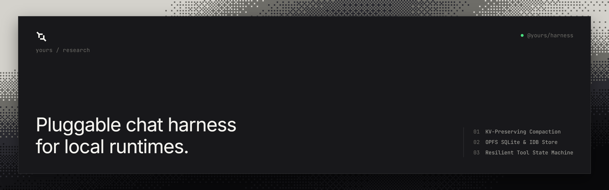
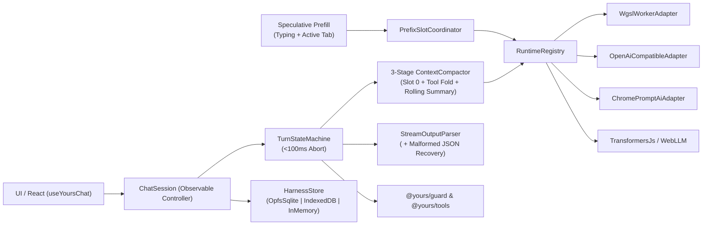

<p align="center">
  <a href="https://yours.sh">
    <picture>
      <source media="(prefers-color-scheme: dark)" srcset="https://raw.githubusercontent.com/yours-research/yours-harness/main/assets/hero-dark.png" />
      <source media="(prefers-color-scheme: light)" srcset="https://raw.githubusercontent.com/yours-research/yours-harness/main/assets/hero-light.png" />
      
    </picture>
  </a>
</p>

<p align="center">
  <a href="https://yours.sh">yours.sh</a> ·
  <a href="https://github.com/yours-research">GitHub Org</a> ·
  <a href="https://huggingface.co/yours-research">Hugging Face</a> ·
  <a href="https://x.com/yoursdotsh">X (@yoursdotsh)</a>
</p>

---

**`@yours/harness`** is a zero-lock-in, runtime-agnostic local LLM chat and agent harness SDK engineered for **fixed-VRAM browser and edge runtimes** (Chrome MV3 extensions, WebGPU workers, and web demos).

It brings together **KV-cache–preserving 3-stage context compaction**, an **explicit agentic turn state machine** with `<100ms` abort teardown, **speculative typing & active-tab prefix scheduling**, **tolerant local-model stream parsing** (`<think>` + malformed JSON recovery), **crash-recoverable DAG persistence**, and **React / headless UI hooks** behind one clean TypeScript API.

## Key Capabilities

- **Pluggable Local Runtimes (`@yours/harness/adapters`)**: Unified `RuntimeAdapter` contract & `RuntimeRegistry` supporting `WgslWorkerAdapter` (Rust WASM + WGSL WebGPU), `TransformersJsAdapter`, `WebLlmAdapter`, `ChromePromptAiAdapter` (`LanguageModel`), and `OpenAiCompatibleAdapter` (Ollama, `llama.cpp` server, vLLM).
- **KV-Cache–Preserving Context Compaction (`@yours/harness/compaction`)**:
  1. **Immutable Slot 0**: Deterministically pins system prompt, canonically sorted tool schemas, and sorted profile memory so GPU KV / DeltaNet prefix states stay hot across turns.
  2. **Transient Tool-Result Folding**: Collapses bulky raw DOM/search payloads from completed turns into concise semantic citations while preserving `tainted` security flags and final assistant answers.
  3. **Block-Aligned Rolling Summary**: Deterministic token-budget planner reserving headroom for `<think>` + output and compacting history in aligned blocks so KV prefix locality stays intact.
- **Speculative UX & Turn FSM (`@yours/harness/engine`)**:
  - Finite state machine: `idle → prefilling → compacting → streaming → awaiting_approval → tool_executing → done | aborted`.
  - Streaming parser tolerant of interleaved/unclosed `<think>` blocks, XML `<tool_call>` tags, truncated/malformed JSON, and stop-sequence tails.
  - `TypingSpeculativePrefillController`, `ActiveTabSpeculativePrefillController`, and `PrefixSlotCoordinator` with FNV-1a deduplication and divergence cancellation.
- **Durable Branching Persistence (`@yours/harness/storage`)**:
  - Thread & message DAG (edit-and-regenerate branching + `< 1 / 2 >` branch switching), tool traces, telemetry, and lexical/FTS5 search across `OpfsSqliteStore` (Worker RPC), `IndexedDbStore`, and `InMemoryStore`.
- **UI Ready (`@yours/harness/controller`, `@yours/harness/react`)**:
  - Event-driven `ChatSession` compatible with `useSyncExternalStore`, plus an optional lightweight `useYoursChat` React hook.

## Architecture



## Installation

```bash
npm install @yours/harness
```

Requires **Node `>= 20.0.0`** (or modern Chromium / Web Worker / MV3 environment). React (`>= 18.0.0`) is an optional peer dependency only needed if importing `@yours/harness/react`.

## Quickstart

### 1. Headless `ChatSession` (Ollama / `llama.cpp` / WGSL Worker)

```ts
import {
  ChatSession,
  InMemoryStore,
  OpenAiCompatibleAdapter,
  RuntimeRegistry,
} from '@yours/harness';

const registry = new RuntimeRegistry().register(
  'ollama',
  new OpenAiCompatibleAdapter({
    baseUrl: 'http://localhost:11434/v1',
    model: 'qwen3.5:4b',
  }),
);

const session = new ChatSession({
  adapter: registry.getDefault(),
  store: new InMemoryStore(),
  systemPrompt: 'You are a concise, accurate local assistant.',
});

await session.init();
await session.sendMessage('Explain WebGPU subgroup matrix multiplication.');

console.log(session.getSnapshot().messages);
```

### 2. React Hook (`@yours/harness/react`)

```tsx
import { WgslWorkerAdapter, createWorkerTransport } from '@yours/harness/adapters';
import { useYoursChat } from '@yours/harness/react';

export function ChatPanel({ worker }: { worker: Worker }) {
  const adapter = new WgslWorkerAdapter({
    transport: createWorkerTransport(worker),
    defaultPacingMode: 'balanced',
  });

  const chat = useYoursChat({
    adapter,
    enableSpeculativeTyping: true,
  });

  return (
    <div>
      {chat.messages.map((m) => (
        <div key={m.id}>
          <strong>{m.role}:</strong> {m.content}
        </div>
      ))}
      {chat.isGenerating && <p>{chat.streamingText}</p>}
      <input
        onChange={(e) => chat.setComposerText(e.target.value)}
        onKeyDown={(e) => e.key === 'Enter' && void chat.send(e.currentTarget.value)}
      />
    </div>
  );
}
```

### 3. Standalone 3-Stage Context Compaction

```ts
import { ContextCompactor } from '@yours/harness/compaction';

const compactor = new ContextCompactor({
  maxContextTokens: 8192,
  reservedOutputTokens: 1024,
  preserveRecentMessages: 4,
});

const plan = await compactor.compact({
  systemPrompt: 'You are Pragma.',
  tools,
  profileMemories,
  messages: conversationHistory,
});

console.log(plan.slot0.slotKey, plan.kvPrefixPreservedTokens, plan.foldedToolCount);
```

## API Reference

| Subpath | Key Exports |
| --- | --- |
| `@yours/harness` | All shared contracts (`RuntimeAdapter`, `GenerateRequest`, `StreamDelta`, `HarnessMessage`, `GuardEngine`, `MemoryProvider`) + all modules |
| `@yours/harness/adapters` | `RuntimeRegistry`, `WgslWorkerAdapter`, `OpenAiCompatibleAdapter`, `ChromePromptAiAdapter`, `TransformersJsAdapter`, `WebLlmAdapter` |
| `@yours/harness/compaction` | `ContextCompactor`, `buildSlot0Envelope`, `foldTransientToolResults`, `extractiveSummarize`, `measureKvPrefixOverlap` |
| `@yours/harness/engine` | `TurnStateMachine`, `runHarnessTurn`, `StreamOutputParser`, `parseLenientJsonObject`, `TypingSpeculativePrefillController`, `ActiveTabSpeculativePrefillController`, `PrefixSlotCoordinator` |
| `@yours/harness/storage` | `InMemoryStore`, `IndexedDbStore`, `OpfsSqliteStore`, `createSqliteWorkerRpcExecutor` |
| `@yours/harness/controller` | `ChatSession`, `ChatSessionSnapshot`, `ChatSessionOptions` |
| `@yours/harness/react` | `useYoursChat`, `UseYoursChatOptions`, `UseYoursChatResult` |

## Yours Research Ecosystem

| Package | Role | Link |
| --- | --- | --- |
| `@yours/tools` | Canonical browser, sandbox, and document tool schemas & executors | [`yours-tools`](https://github.com/yours-research/yours-tools) |
| `@yours/harness` | Runtime-agnostic chat & agent harness, KV compaction, and persistence | [`yours-harness`](https://github.com/yours-research/yours-harness) |
| `@yours/memory` | Tiered local memory (`working`, `profile`, `episodic`, `document`) & encrypted export | [`yours-memory`](https://github.com/yours-research/yours-memory) |
| `@yours/models` | Verified model manifests (Ed25519 + Merkle) and WebGPU hardware prober | [`yours-models`](https://github.com/yours-research/yours-models) |
| `@yours/guard` | Indirect prompt injection (IDPI) spotlighting & lethal-trifecta policy guard | [`yours-guard`](https://github.com/yours-research/yours-guard) |
| `@yours/voice` | Local STT/TTS voice pipeline with VAD and barge-in | [`yours-voice`](https://github.com/yours-research/yours-voice) |
| `@yours/evals` | Cross-stack correctness, latency, and security eval scorecards | [`yours-evals`](https://github.com/yours-research/yours-evals) |
| `yours-browser-extension` | Chromium MV3 + Rust WASM/WGSL local browser assistant | [`yours-browser-extension`](https://github.com/yours-research/yours-browser-extension) |

---

<p align="center">
  <strong>yours / research</strong> · Making local inference for everyone.
</p>
